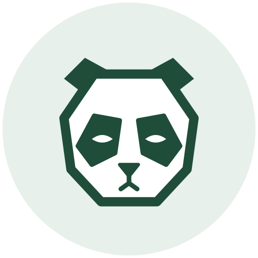
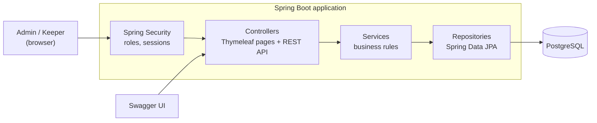

# ZooCare

Zoo keeper management system

<p align="center">
  
</p>

<p align="center">
  
  
  
  
  
  
  
  
  
  
  
  
</p>

---
## 📌 About the project

ZooCare is a web application that helps a zoo take care of its animals. The zoo manager organizes species, enclosures, animals and keepers. Keepers see which of their animals are due for feeding and record every feeding.

Keepers used to track feedings on paper or in spreadsheets, so feedings were missed or doubled, managers had no overview, and nobody could look back at how an animal had been eating. ZooCare keeps all of this in one place and enforces the zoo's rules automatically.

**Live version:** https://team5.acnbootcamp.lv

---
## ⚙️ Features

### 🔐 Accounts and roles
- Registration (new accounts are always keepers)
- Login and logout with role-based access (`ADMIN`, `KEEPER`)
- A default admin account is created on first start

### 🛠️ Admin
- Create, edit and delete **species**, **enclosures** and **animals**
- Move an animal to another enclosure
- Assign keepers to enclosures and remove them (assignment history is kept)
- Make a user an admin, delete a user
- See the **feeding history of all animals**

### 🧑‍🌾 Keeper
- Sees only the enclosures and animals they are assigned to
- Dashboard "Due for feeding": which animals can be fed right now, most overdue first
- Records feedings (food, amount, note) for animals in their own enclosures

### ✅ Business rules (checked on every request)
- The habitat of a species must match the habitat of its enclosure
- An enclosure cannot hold more animals than its capacity
- An animal cannot be fed again before its feeding interval has passed
- A keeper can feed only animals in enclosures they are assigned to
- Only users with the keeper role can be assigned to an enclosure, and not twice
- Species, enclosure and animal names are unique
- A species or enclosure that is in use cannot be deleted, and its habitat or capacity cannot be changed to contradict its animals
- Invalid input returns clear field errors; every API error uses one JSON format

---
## 👥 Roles

| | Admin | Keeper |
|---|---|---|
| Species, enclosures, animals: create, edit, delete | ✔ | read only |
| Assign keepers to enclosures | ✔ | |
| Manage users (make admin, delete) | ✔ | |
| View all feeding history | ✔ | |
| See own enclosures and "Due for feeding" | | ✔ |
| Record a feeding | | ✔ (own enclosures only) |

---
## 🛠️ Tech stack

| Component | Technology |
| --- | --- |
| **Backend** | Java 21, Spring Boot 4.1 (Web, Data JPA, Security, Validation) |
| **Database** | PostgreSQL (H2 in-memory for local development) |
| **UI** | Thymeleaf, Bootstrap 5 |
| **API docs** | springdoc-openapi (Swagger UI) |
| **Testing** | JUnit 5, Mockito, MockMvc, Spring Security Test |
| **Build and run** | Maven, Docker, Docker Compose |
| **Delivery** | GitHub (protected `main`, pull requests, reviews), GitHub Actions |

---
## 🧱 Architecture



```
com.zoo.care
 ├─ controller   pages (Thymeleaf) and REST controllers
 ├─ service      business rules and transactions
 ├─ repository   Spring Data JPA, custom queries
 ├─ entity       domain model
 ├─ dto          requests and responses
 ├─ config       security, Swagger, clock
 └─ exception    case-specific exceptions, global error handler
```

**Data model:** `User` · `Species` · `Enclosure` · `Animal` · `KeeperAssignment` · `Feeding`

---
## 🚀 Getting started

### 🔧 Requirements
- Java 21 (the Maven wrapper is included)
- Docker and Docker Compose (only for the PostgreSQL option)

### 📥 1. Clone the repository
```bash
git clone https://github.com/SairnaD/zoocare.git
cd zoocare
```

### ▶️ 2a. Quick start (in-memory H2, no database needed)
```bash
./mvnw spring-boot:run
```
On Windows use `.\mvnw spring-boot:run`. Open http://localhost:8080 and log in as `admin` with password `admin12345` (development default, local profile only).

### 🐘 2b. With PostgreSQL in Docker
Create a `.env` file next to `docker-compose.yml` (it is git-ignored):
```
DB_PASSWORD=choose-a-db-password
ADMIN_PASSWORD=choose-an-admin-password
```
Then build and start:
```bash
./mvnw clean package -DskipTests
docker compose up --build
```
Open http://localhost:8080 and log in as `admin` with the password from `.env`. Stop with `docker compose down` (add `-v` to also delete the data).

### 🔧 Configuration

| Variable | Meaning | Default |
| --- | --- | --- |
| `SPRING_PROFILES_ACTIVE` | `h2` or `postgres` | `h2` |
| `DB_URL`, `DB_USER`, `DB_PASSWORD` | PostgreSQL connection (profile `postgres`) | localhost, `zoocare` |
| `ADMIN_USERNAME` | first admin account | `admin` |
| `ADMIN_PASSWORD` | first admin password | `admin12345` on `h2`, **required** on `postgres` |
| `SERVER_PORT` | HTTP port | `8080` |

The admin account is created only if it does not exist yet, so changing `ADMIN_PASSWORD` later does not change an existing admin's password.

---
## 🧪 Usage walkthrough

1. **Register** a keeper account on the registration page (or use an existing one).
2. **Log in as admin.** Create a species (for example Lion, savanna), then an enclosure (Savanna 1, savanna, capacity 3).
3. Open **Keepers** on the enclosure and assign the keeper.
4. **Register an animal** (Leo, Lion, Savanna 1, feeding interval 6 hours). Try an arctic enclosure or a full enclosure to see the rules reject it.
5. **Log in as the keeper.** Leo is on the "Due for feeding" dashboard.
6. **Record a feeding.** Leo leaves the dashboard; recording again too early is rejected with the time of the next allowed feeding.
7. **As admin**, open the feeding history to see all feedings.

---
## ✅ Testing

```bash
./mvnw clean verify
```
Runs **300+ automated tests** without any external database:
- **Unit tests** of the services (business rules and failure cases) with Mockito
- **MockMvc tests** of every controller: validation, status codes, roles, CSRF
- **Repository tests** with the time boundaries of keeper assignments and feeding queries
- **Security and end-to-end tests**: login, role access, recording a feeding and seeing it on the dashboard

---
## 📖 API

Interactive documentation: **`/swagger-ui.html`** (OpenAPI JSON at `/v3/api-docs`). Log in first, the API uses the same session.

| Area | Endpoints |
| --- | --- |
| Species | `/api/species` (read: any user, changes: admin) |
| Enclosures and keepers | `/api/enclosures`, `/api/enclosures/{id}/keepers` (admin) |
| Animals | `/api/animals` (admin) |
| Feedings | `POST /api/animals/{id}/feedings` (keeper of the animal's enclosure) |

Errors use one JSON body: `timestamp`, `status`, `error`, `message`, `path`, `fieldErrors`.

---
## ☁️ Deployment

Every push to `main` is built and deployed by **GitHub Actions** to the company server: the application and PostgreSQL run as Docker containers in a private network, the database data lives in a persistent volume, and credentials come from GitHub Secrets (`DB_PASSWORD`, `ADMIN_PASSWORD`).

---
## 📈 Future work
- Animal photos
- Vaccinations and health checks
- Overdue feeding notifications
- Statistics and report export (CSV / PDF)
- Soft delete (archive) for animals

---
## 👥 Team

**Team 5**, Accenture Java / Software-Engineer Bootcamp

- Daniils Nils Gosperskis
- Artur Pereberin
- Dmitrijs Macegors
- Nikita Berdnikovs
- Rainers Ninuks
